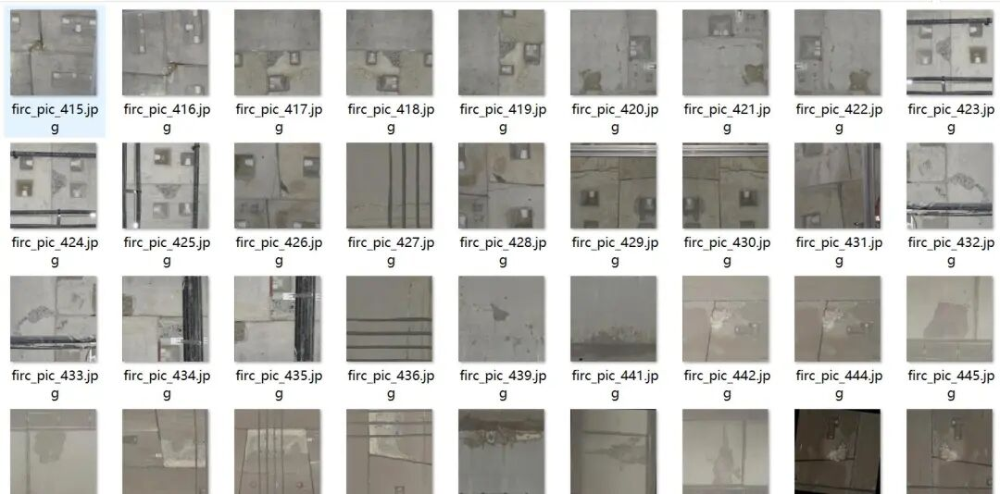
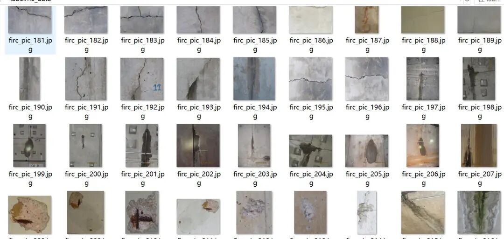
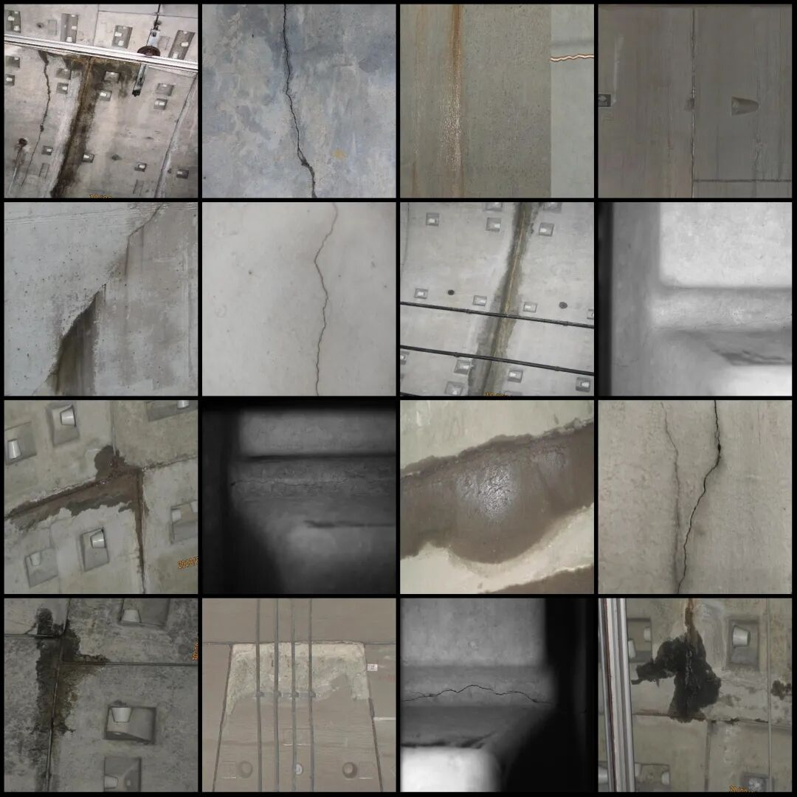
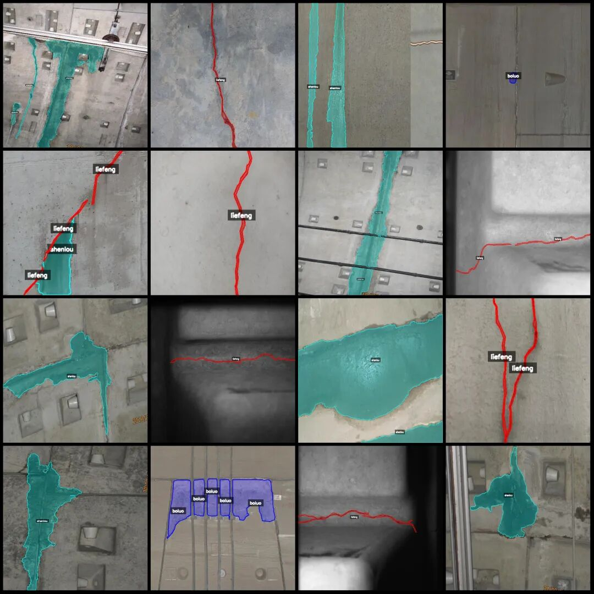
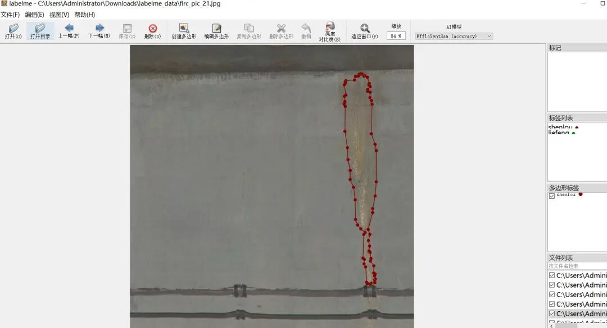

# Highway Tunnel and Railway Tunnel Crack, Leakage, and Delamination Identification and Segmentation Dataset - LabelMe format: 471 images in 3 categories

Dataset format: labelme format (without mask files, only including jpg images and corresponding json files)

Number of images (number of jpg files): 471

Number of annotations (number of json files): 471

Label category count: 3

Annotation category names: ["boluo", "liefeng", "shenlou"]

Matched Chinese category name: ["Peeling", "Cracks", "Leakage"]

Number of boxes labeled in each category:

boluo count = 124

liefeng count = 214

shenlou count = 308

Total frame count: 646

Using labeling tool: labelme=5.5.0

Image resolution: Multi-resolution images, such as 1400x1200, 1600x1200, etc.

Annotation rules: Draw polygons around the categories.

Important Notice: The dataset can be opened and edited using LabelMe. For JSON datasets, one must convert them into mask or Yolo formats for semantic segmentation or instance segmentation.

Special : This dataset does not guarantee the accuracy of the trained models or weight files.

Image Preview:

Annotation example:

Original image (pick 16 randomly):

Annotation:

LabelMe editing example:

## Payment

Here is a pay link on Stripe ( https://buy.stripe.com/3cs8yP7sY87d0vu9AB ). Please contact me lonlonago@foxmail.com after funding $89, and I will send you a complete data files , thank you!

